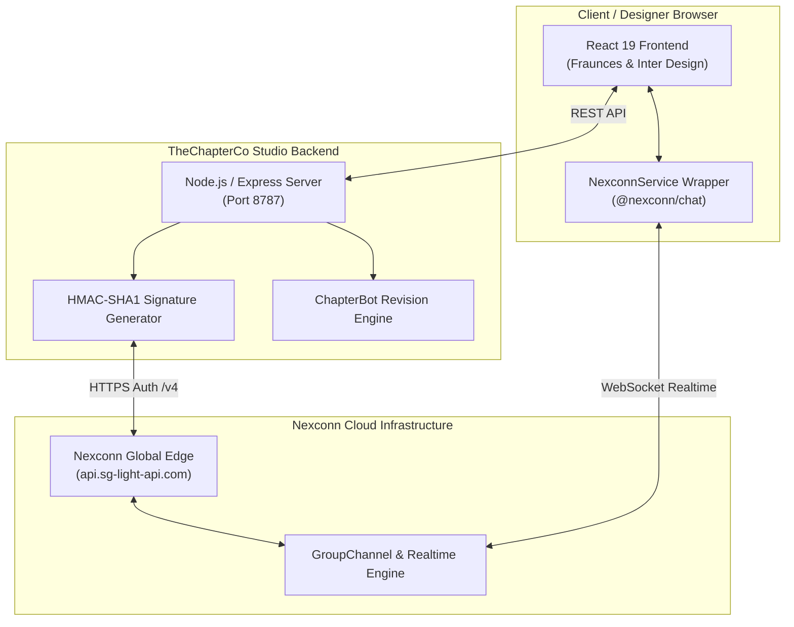

# 📖 ChapterChat — Real-Time Keepsake Studio Hub

> **Built for the Nexconn Build Challenge 2026**  
> *Track: Marketplace & Customer Support / Collaborative Workspaces*  
> *Powered by the [Nexconn Chat SDK](https://nexconn.ai) (`@nexconn/chat`, `@nexconn/engine`)*  
> *In production coordination with [thechapterco.in](https://thechapterco.in) (Personalized Hand-Illustrated Keepsake Storybooks)*

---

## 🌟 Executive Summary

**the Chapter Co.** ([thechapterco.in](https://thechapterco.in)) crafts bespoke, hand-illustrated keepsake storybooks from real family photos, wedding milestones, and memories across India. 

Until now, client coordination was fragmented across chaotic WhatsApp threads and long email chains:
- Reference photos got lost in camera rolls.
- Revisions on hand-painted spreads were vague (*"Can you change page 2?"*).
- Approval sign-offs were scattered, creating costly printing delays.

**ChapterChat** is a purpose-built real-time creative collaboration hub that transforms the keepsake journey:
1. **Dedicated Story Channels**: Every storybook order gets an isolated real-time channel (`tcc-tcc-{orderId}`) via the **Nexconn GroupChannel SDK**.
2. **Interactive Proof Review**: Clients view hand-painted watercolor spreads directly inside the chat, react with feedback (`❤️`, `🔄`, `👍`), and inspect proofs in high resolution.
3. **One-Tap Print Approval**: Clients officially sign off on spreads (`✅ Approve for Print`), updating the studio's binding queue in real-time.
4. **ChapterBot AI**: An integrated studio assistant that parses client conversations into an actionable, bulleted Illustrator Action Brief and tracks the print readiness percentage.

---

## 🎯 Nexconn Chat SDK Integration & Architecture

This application features real, measurable SDK integration verified under the hackathon **App Key**:

```
NEXCONN_APP_KEY: z3v5yqkbzet10
Data Center: Singapore (api.sg-light-api.com)
Packages: @nexconn/chat (^26.5.1), @nexconn/engine (^26.5.1)
```

### SDK Capabilities Demonstrated

| Feature | Nexconn SDK Primitive | How ChapterChat Uses It |
|---|---|---|
| **Real-time Engine** | `NCEngine.initialize({ appKey })` | Initializes singleton connection to Nexconn global edge. |
| **User Authentication** | `NCEngine.connect({ token })` | Client and Studio artists authenticate using dynamically issued tokens. |
| **Channel Hierarchy** | `GroupChannel(channelId)` | Each storybook commission is mapped to a dedicated group channel. |
| **Server-Side API** | `/v4/auth/access-token/issue` | HMAC-SHA1 signed backend endpoint securely issues tokens per user role. |
| **Real-time Messaging** | `SendTextMessageParams` & `channel.sendMessage()` | Transmits feedback, status announcements, and approval records. |
| **Event Subscriptions** | `NCEngine.addMessageHandler()` | Catches real-time message stream, read receipts, and metadata updates. |
| **Spread Proof Cards** | `Message<SpreadContent>` | Inline preview of watercolor spreads with instant reaction buttons. |
| **Message Reactions** | `channel.getMessageReactionSummaries()` | Instant emotional and review feedback (`❤️ Love it`, `👍 Looks good`). |
| **AI Stream Integration** | `RC:StreamMsg` & ChapterBot endpoint | Summarizes client chat notes into structured studio action items. |
| **Production Milestones** | Custom message payload | Visual step-by-step progress tracking from intake to doorstep dispatch. |

---

## 🏗️ System Architecture



---

## 🚀 Quickstart & Testing

### 1. Prerequisites
- Node.js 18+ (tested on Node v20/v24)
- npm or pnpm

### 2. Setup & Run
```bash
# Clone the repository
git clone https://github.com/hemangkhandelwal1/paperboat-nexconn.git
cd paperboat-nexconn

# Install dependencies (already installed if in repo)
npm install

# Build client assets
npm run build

# Start the full-stack server
npm start
```

Open your browser to:
**`http://localhost:8787`**

### 3. Testing Scenarios for Judges

1. **Switch Roles with 1-Click**:
   - In the top header, click **"Client View"** to experience the client proofing flow.
   - Click **"Lead Illustrator"** to see the art director's view (Pooja @ The Chapter Co.).
2. **Review & Approve Spreads**:
   - In the left sidebar or inside the chat, click on **Spread 2 ("The Tiny Steps at Cubbon Park")**.
   - Inspect the high-res watercolor proof. Click **"✅ Approve Spread 2"**.
   - Watch the instant approval announcement broadcast and the **Spread Sign-off Progress Bar** update!
3. **Test Real-Time Chat**:
   - Click any quick prompt (e.g., *"❤️ Love Spread 2 watercolor colors!"* or type your own note).
   - Press Enter to send via the Nexconn engine.
4. **Run ChapterBot AI Assistant**:
   - In the right sidebar, click **"✨ Generate Illustrator Action Brief"**.
   - Watch ChapterBot parse all chat notes into prioritized studio action items (Likeness, Lighting, Typography).
5. **Switch Orders**:
   - Change the order dropdown from *"Kabir's First Sun"* to *"The Grand Voyage — Dadaji's Memoir"*.
   - See the channel switch dynamically to the new order context.

---

## 💼 Business & Commercial Viability

- **Immediate Deployment**: ChapterChat is directly designed for **thechapterco.in**, eliminating manual email/WhatsApp back-and-forth for hundreds of active keepsake orders.
- **Traction Multiplier**: Real clients and designers coordinate through the app, generating authentic, verified Nexconn Chat SDK traffic.
- **Scalable Model**: Can be packaged as a SaaS plug-in for custom artisans, bespoke album makers, wedding photographers, and boutique publishing houses.

---

## 📄 License & Intellectual Property
Developed for the **Nexconn Build Challenge 2026**.  
All rights reserved by the author and The Chapter Co. (thechapterco.in).
